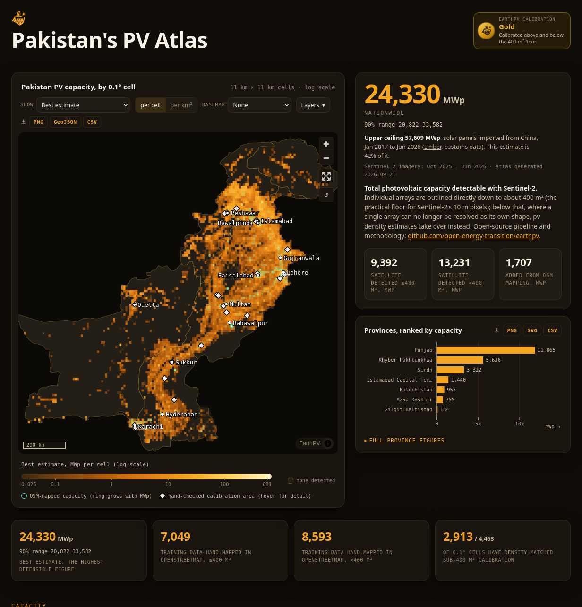
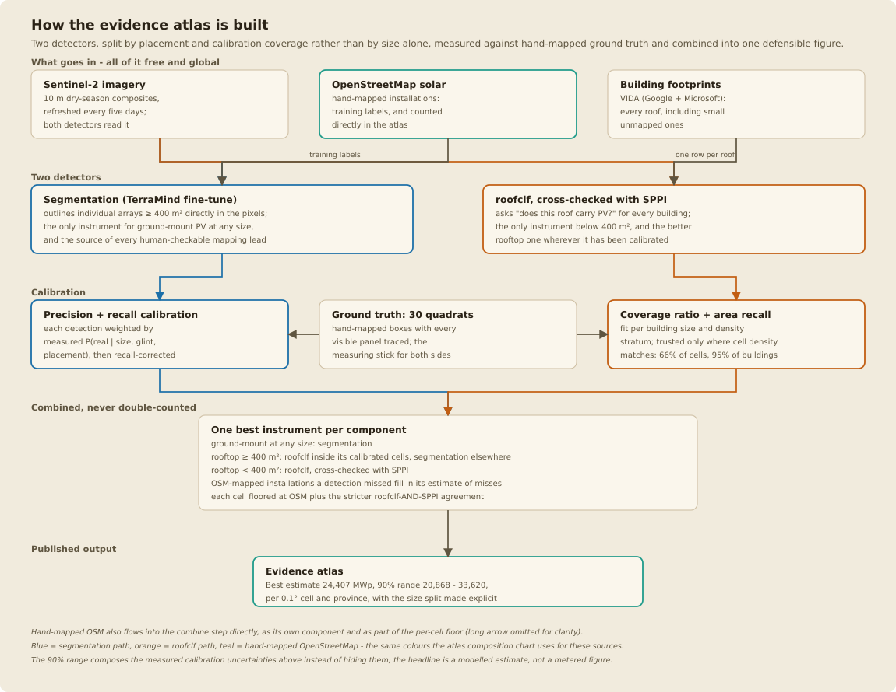
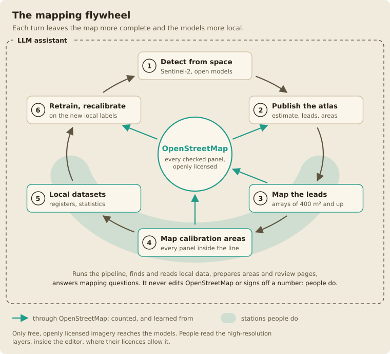

<div align="center">

<picture>
  <source media="(prefers-color-scheme: dark)" srcset="docs/assets/figures/earthpv-logo-mark-white.png">
  
</picture>

# EarthPV

**Free, Open and Global Mapping of Photovoltaic Systems Above 10 kWp**   
**Including Capacity, Growth and Orientation**

[Documentation](https://open-energy-transition.github.io/earthpv/) &nbsp;·&nbsp;
[Country atlases](https://open-energy-transition.github.io/earthpv/atlas/) &nbsp;·&nbsp;
[Set up a new country](https://open-energy-transition.github.io/earthpv/reproduce/) &nbsp;·&nbsp;
[Experiments](https://open-energy-transition.github.io/earthpv/experiments/) &nbsp;·&nbsp;
[Discord](https://discord.gg/T5zh6N24Hv)

</div>

---

> [!WARNING]
> **Active development.** EarthPV is alpha-stage research software. Its detectors,
> calibration and headline numbers are still being tested and revised, not settled.

Many countries do not know how much solar power sits on their roofs, or where. EarthPV
answers that from space with free data: it detects PV arrays in Sentinel-2 satellite
imagery, turns them into capacity estimates, and hands each detection to OpenStreetMap
mappers to verify. What they confirm trains the next model. Built only on open models and
global datasets, it works for any country.

<p align="center">
  <a href="https://www.youtube.com/watch?v=0FiXLT_kNv0">
    
  </a>
</p>

<p align="center"><em>Watch <a href="https://www.youtube.com/watch?v=0FiXLT_kNv0">We are
mapping solar panels in every country</a>, EarthPV explained by Open Energy Transition.</em></p>

## Country atlases

Each country gets an interactive **evidence atlas**: hand-mapped OpenStreetMap
installations plus the model's own detections, per 0.1&deg; cell, with a 90% range on the
headline figure.

| Country | What the atlas rests on |
| --- | --- |
| [Pakistan](https://open-energy-transition.github.io/earthpv/atlas/) | Both detectors, calibrated on 30 hand-mapped areas |
| [Germany](https://open-energy-transition.github.io/earthpv/atlas-germany/) | Both detectors, the small-rooftop half calibrated against the national register (MaStR) |
| [France](https://open-energy-transition.github.io/earthpv/atlas-france/) | Segmentation, checked against the national register (ODRE) |
| [India](https://open-energy-transition.github.io/earthpv/atlas-india/), [Vietnam](https://open-energy-transition.github.io/earthpv/atlas-vietnam/), [South Africa](https://open-energy-transition.github.io/earthpv/atlas-south-africa/), [Morocco](https://open-energy-transition.github.io/earthpv/atlas-morocco/), [Egypt](https://open-energy-transition.github.io/earthpv/atlas-egypt/), [Nigeria](https://open-energy-transition.github.io/earthpv/atlas-nigeria/), [Zambia](https://open-energy-transition.github.io/earthpv/atlas-zambia/), [Yemen](https://open-energy-transition.github.io/earthpv/atlas-yemen/) | Segmentation only, until hand-mapped calibration areas or a register exist |

<p align="center">
  <a href="https://open-energy-transition.github.io/earthpv/atlas/">
    
  </a>
</p>

## How it works

At Sentinel-2's 10 m resolution a large array has a shape you can trace and a small one does
not, so EarthPV runs two instruments and combines them.

- **Segmentation**, the fine-tuned TerraMind, outlines arrays above roughly 400 m². Every
  detection becomes a ranked mapping lead, and it is the only instrument for ground-mounted
  solar at any size.
- **roofclf** asks a smaller question of every building: *does this roof carry PV?* A 100
  m² array is a handful of mixed pixels, too few to outline but often enough to classify. It
  is cross-checked with SPPI, a zero-training spectral index, and calibrated on areas where
  every installation was mapped by hand.

`earthpv atlas` combines both with the hand-mapped OpenStreetMap layer into a **Best
estimate**, with overlaps removed and a 90% range attached. A country with neither
hand-mapped calibration areas nor a register gets the segmentation half only.

<p align="center">
  
</p>

**The OpenStreetMap loop.** Sentinel-2 is free but coarse; Esri, Bing and Mapbox resolve
individual panels but only let a *person* trace from them in the OpenStreetMap editor. So
the model reads only Sentinel-2, people read only the high-resolution layers, and what they
map becomes openly licensed training data for the next model.

<p align="center">
  
</p>

**Keeping it current.** An update is a re-run on new imagery, and each round starts from a
better map: confirmed leads become verified capacity and training data. See
[Keeping PV data current](https://open-energy-transition.github.io/earthpv/maintenance/).

The same detections also give panel tilt and orientation from Sentinel-2
[glint](https://open-energy-transition.github.io/earthpv/results/pv-pose/) and
[growth](https://open-energy-transition.github.io/earthpv/results/growth/) since 2021/22.
Everything tried, kept or rejected, with the measurement behind each verdict, is in
[Experiments](https://open-energy-transition.github.io/earthpv/experiments/).

## How small an installation does it find?

Measured on 30 exhaustively hand-mapped Pakistani calibration areas (123,898 buildings), at
the operating point the published atlas uses:

| Panel area on the roof | Roughly | Found |
| -- | -- | -- |
| Above 100 m² | above 20 kWp | 92% rising to over 99% |
| 50 to 100 m² | 10 to 20 kWp | 83% |
| 20 to 50 m² | 4 to 9 kWp | 49% |
| Below 20 m² | below 4 kWp | 22 to 31% |

**Most rooftop PV above about 50 m² of panel (roughly 10 kWp) is found, 20 to 50 m² is close
to a coin flip, and most smaller systems are missed.** Detection is recall-first: about 1 in
10 PV-free buildings is also flagged, so detections are leads for human verification, not a
finished inventory. Where household systems are a fraction of a pixel, as in France, the
small-rooftop half does not work at all.

## Add your country

The goal is a global atlas assembled country by country, each run and checked by people who
know the ground. Every input is global, so the intended shape is a fork per country with the
results coming back here. There is no combiner that merges countries into one global surface
yet; the shared pipeline, atlas format and data-pack layout are what make that possible
later.

```bash
gh repo fork open-energy-transition/earthpv --clone --remote
cd earthpv && git switch -c atlas/<country>

pixi run python scripts/new_region.py check --bbox <bbox> --iso3 <ISO3>   # preflight
pixi run python scripts/new_region.py add   --aoi <country> --bbox <bbox> --iso3 <ISO3>
pixi run python scripts/new_region.py plan  --aoi <country>               # your runbook
```

Every stage is resumable; `compose`, which builds the imagery, is the long pole at days on a
home connection. Package the per-cell capacity table with `scripts/build_atlas_data_pack.py`
and ship it as a GitHub Release asset: commit the manifest, never the pack. One step cannot
be automated: after national `roofclf` scoring, check 20 random cells against
high-resolution imagery.

**Working with an agent such as Claude Code?** `CLAUDE.md` is the repository's agent brief.
Let it run the preflight, the config, the long stages and the draft page, and stop it before
anything that needs human eyes: drawing or certifying calibration areas, and signing off
validation. Full runbook:
[Contribute your country atlas back](https://open-energy-transition.github.io/earthpv/reproduce/#contribute-your-country-atlas-back).

## Community

EarthPV is the software half of **TraceTheSun**, a pilot run by
[Open Energy Transition](https://openenergytransition.org) to make PV mapping
cost-effective, verifiable, community-driven and local, worldwide, conceived by
[Tobias Augspurger](https://www.linkedin.com/in/tobias-augspurger/) and
[Muhammad Awais](https://www.linkedin.com/in/awais307/). The Pakistani results rest on a
student team at the **[Centre for Water Informatics and Technology (WIT)](https://wit.lums.edu.pk/)**,
Lahore University of Management Sciences:
[Laeeba Hafeez Malik](https://www.linkedin.com/in/laeeba-hafeez-malik-220b63328/),
[Tayyiba Shafiq](https://www.linkedin.com/in/tayyiba-shafiq/),
[Nimra Aamir Ali](https://www.linkedin.com/in/nimra-aamir-ali-417b98249/) and
[Vania Malik](https://www.linkedin.com/in/vania-malik-799bbb343/), who co-designed the
pipeline and did the mapping, validation and ground-truth work that makes the numbers
checkable. [Join the community on Discord](https://discord.gg/T5zh6N24Hv).

## Licence

Code MIT. Imagery from Copernicus Sentinel-2; building footprints from VIDA Open Buildings
and Overture Maps; labels from OpenStreetMap contributors under ODbL; administrative
boundaries from geoBoundaries under CC-BY.

**Published data outputs** (the atlases, capacity tables, raw detections and any other
derived dataset offered for download) are derivative databases of OpenStreetMap's solar
labels and, via VIDA Open Buildings, of Microsoft and Google building footprints, so under
ODbL's share-alike clause **they are licensed under the
[Open Database License (ODbL) v1.0](https://opendatacommons.org/licenses/odbl/1-0/)**. Any
use must attribute &copy; OpenStreetMap contributors, VIDA Open Buildings (CC BY 4.0) for
the footprints and, for anything derived from the German validation, the
Marktstammdatenregister (Bundesnetzagentur,
[Datenlizenz Deutschland - Namensnennung - Version 2.0](https://www.govdata.de/dl-de/by-2-0)).
